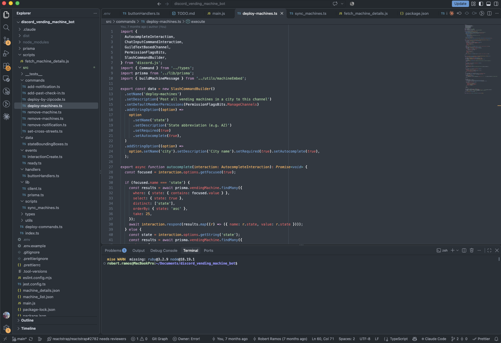
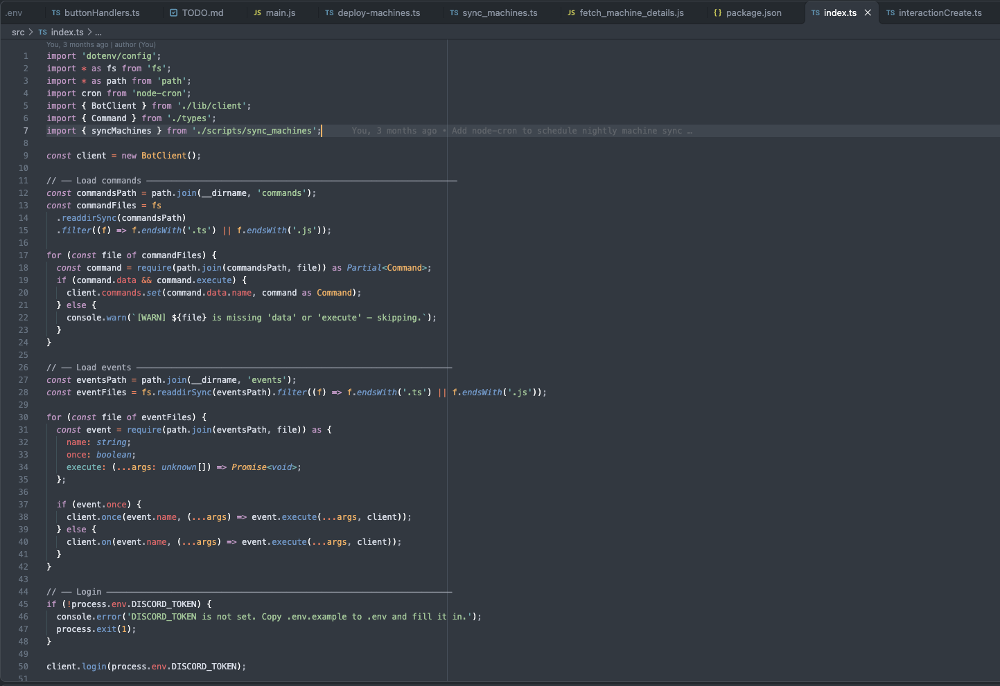

# Trench

A dark VS Code theme in deep slate blue, with teal, orange and pink accents.



## Install

1. Open the Extensions view (`Cmd+Shift+X` on macOS, `Ctrl+Shift+X` elsewhere).
2. Search for **Trench** and click **Install**.
3. Open the Command Palette and run **Preferences: Color Theme**, then choose **Trench**.

## Syntax highlighting



Keywords are pink, functions are blue, strings are green, and numbers and parameters are orange. Storage keywords and built-in types are italic, punctuation is teal, and comments are a muted blue-grey so they stay out of the way.

## Palette

| Color | Hex | Used for |
| --- | --- | --- |
| Slate | `#303841` | Editor background |
| Frost | `#D8DEE9` | Default text |
| Blue | `#6699CC` | Function calls, links |
| Teal | `#5FB4B4` | Punctuation, active guides, accents |
| Green | `#99C794` | Strings |
| Orange | `#F9AE58` | Numbers, parameters, cursor |
| Pink | `#C695C6` | Keywords, attributes |
| Red | `#EC5F66` | Language constants, tags, errors |

## Inspiration

Trench draws its color palette from the Mariana color scheme by Dmitri Voronianski, as shipped with Sublime Text. Thanks to Dmitri for the original.

## Development

`scripts/generate_theme.py` generates `themes/Trench-color-theme.json`:

```bash
python3 scripts/generate_theme.py .
```

To try it locally, symlink this folder into `~/.vscode/extensions` and reload VS Code.

## License

[MIT](LICENSE)
